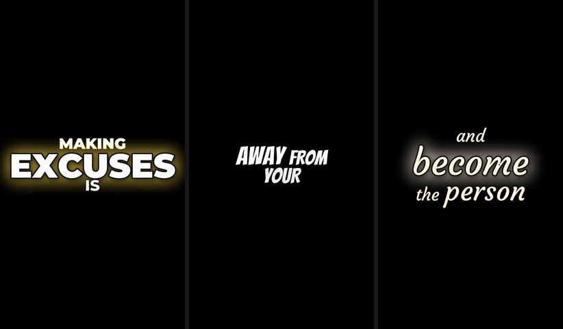
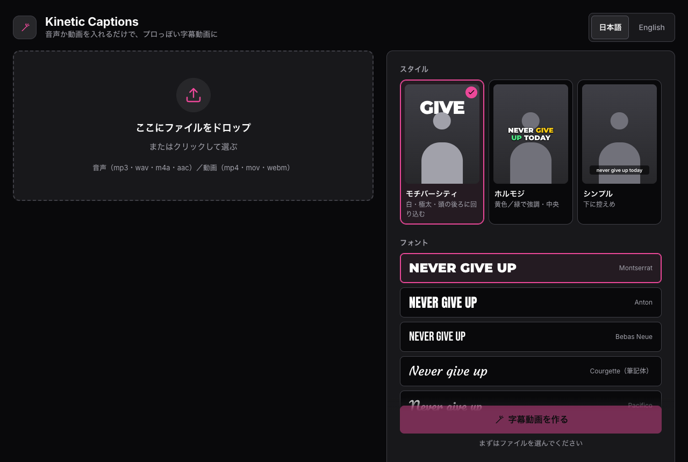

# Kinetic Captions

[English](README.md) | **日本語**

音声か動画を入れるだけで、モチベーション系ショート動画のような「単語ごとに演出が変わる字幕」付きの動画を自動で作るツールです。

## デモ

<p align="center">
  
</p>

同じ音声ファイル1つから、スタイルとフォントだけ変えて作った例です（左から モチバーシティ / ホルモジ＋Bangers / Courgette 筆記体）。強い言葉（EXCUSES, PERFECT, EXIST…）は自動で大きく・光って表示されます。

▶ **音声付きの動画**：[docs/demo_motiversity.mp4](docs/demo_motiversity.mp4)

<p align="center">
  
</p>

### 画面（Web UI）

<p align="center">
  
</p>

ファイルをドロップして、ボタンを押すだけ。スタイル・フォント（Google Fonts から追加も可）・色・サイズ・背景は画面から選べます。

## できること

- **文字おこし**：faster-whisper で単語ごとの時刻を取得し、声の大きさ・高さも分析
- **単語ごとの演出**：強い言葉（NEVER, DREAM, EXCUSES…）、数字、否定語のすぐ後、文の最後、声の強さなどを点数化して、サイズ・色・アニメーション・前後の重なりを自動で決定
- **人物の後ろに文字を回り込ませる**：人物（いなければ物体）を切り抜いて、大きな単語を頭の後ろに配置
- **自動レイアウト**：顔や体を避けて、空いている場所に字幕を配置
- **音声だけでもOK**：黒（または好きな色）の背景に字幕を載せた縦長/横長/正方形の動画を作成
- **背景を消す**：動画の人物だけ残して背景を黒にできる
- **スタイル**：モチバーシティ風 / ホルモジ風 / シンプル
- **フォント**：Montserrat・Anton・Bebas Neue・Courgette（筆記体）に加えて、**Google Fonts のURLや埋め込みコードを貼るだけで好きなフォントを追加**可能（筆記体は自動で小文字表示）

## 動作環境

- macOS（Apple Silicon 推奨）。人物検出に Apple Vision を使うので最速です
- それ以外の環境でも動きます（人物検出は ISNet にフォールバック。かなり遅くなります）
- Python 3.11 以上、[ffmpeg](https://ffmpeg.org/)（`brew install ffmpeg`）

## セットアップ

```bash
git clone <このリポジトリ>
cd kinetic-captions
python3.11 -m venv .venv
.venv/bin/pip install -r requirements.txt
```

（[uv](https://github.com/astral-sh/uv) を使う場合：`uv venv --python 3.11 && uv pip install -r requirements.txt`）

初回の実行時に、文字おこしモデル（faster-whisper）と切り抜きモデル（rembg）が自動でダウンロードされます。

## 使い方

### Web UI（おすすめ）

```bash
.venv/bin/python -m app
```

ブラウザで http://127.0.0.1:7860 を開き、ファイルをドロップして「字幕動画を作る」を押すだけです。設定はすべて「おまかせ」で動きます。画面右上で **日本語 / English** を切り替えられます。

### コマンドライン

```bash
# 動画に字幕を載せる
.venv/bin/python -m kc input.mp4 -o out.mp4 --preset motiversity

# 人物だけ残して背景を黒に
.venv/bin/python -m kc input.mp4 -o out.mp4 --bg black
```

Python から使う場合：

```python
from kc.pipeline import run_job
run_job("voice.mp3", "out.mp4", {"canvas": "9:16", "font": "courgette"})
```

## 仕組み

```
入力 ──┬─ 文字おこし (kc/transcribe.py) ─────┐   ← 同時に実行
       └─ 人物・物体の検出 (kc/matte.py) ─────┤
                                              ├─ 演出を決める (kc/style.py)
                                              ├─ 配置を決める (kc/placement.py)
                                              └─ 書き出し (kc/render.py)
```

| ファイル | 役割 |
|---|---|
| `kc/pipeline.py` | 入口。音声/動画の判定、各段階の実行 |
| `kc/transcribe.py` | faster-whisper による単語単位の文字おこし＋声の大きさ・高さ |
| `kc/style.py`, `kc/lexicon.py` | 単語ごとの強調度の採点と、サイズ・色・アニメーションの決定 |
| `kc/matte.py` | 人物マスク（Apple Vision、動きに合わせて間引き）。人物がいなければ ISNet で物体を検出 |
| `kc/placement.py` | 被写体を避ける / 頭の後ろに回り込ませる自動配置 |
| `kc/render.py`, `kc/anims.py` | フレーム合成（並列）と ffmpeg での書き出し |
| `kc/fonts.py` | フォント管理と Google Fonts からの追加 |
| `app/` | Web UI（Python 標準ライブラリのみ） |
| `bench/` | 速度・品質の計測スクリプト |

**強調したい単語を増やしたいとき**は `kc/lexicon.py` のリストに単語を足してください。色や大きさの基準は `kc/style.py` の `PRESETS` で変えられます。

## 速度の目安

M5 MacBook、19秒の動画（526×278）、キャッシュなしで約8秒。設定を変えて作り直すときは文字おこしを再利用するので数秒で終わります。

## ライセンス

- 同梱フォント（Montserrat / Anton / Bebas Neue / Courgette）は SIL Open Font License です。ライセンス文は `assets/fonts/OFL-*.txt` にあります
- Google Fonts から追加したフォントは `assets/fonts/user/` に保存され、リポジトリには含まれません
