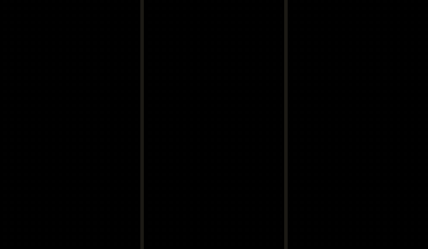
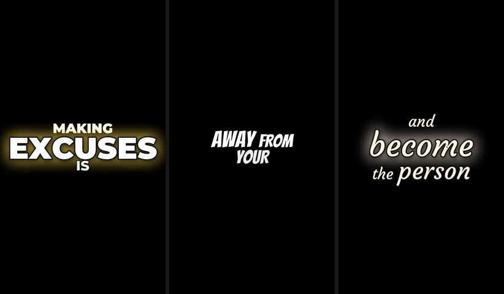
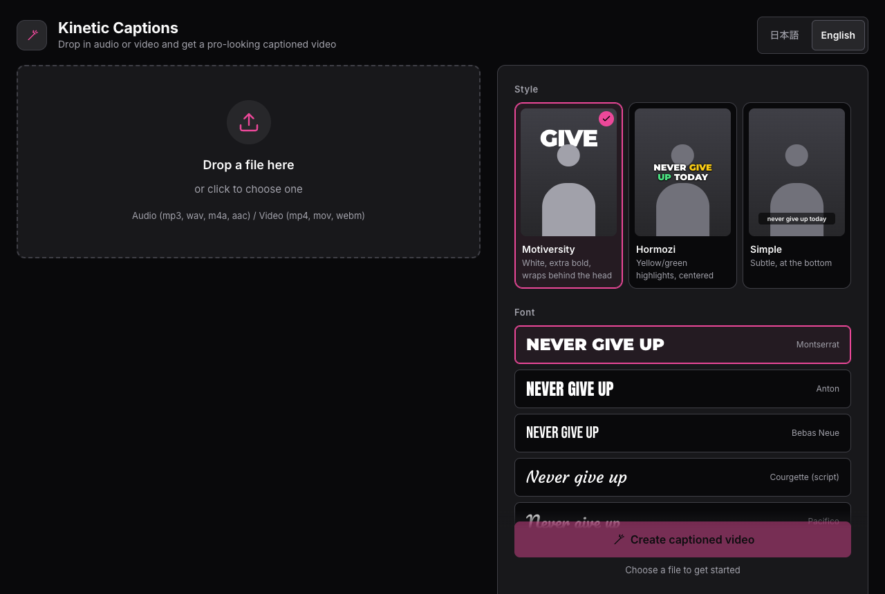

# Kinetic Captions

**English** | [日本語](README.ja.md)

Drop in an audio or video file and get a captioned video in the style of motivational shorts — captions whose size, colour and animation change **word by word**.

## Demo

<p align="center">
  
</p>

All three were made from one audio file, changing only the style and font (left to right: Motiversity / Hormozi + Bangers / Courgette script). Strong words (EXCUSES, PERFECT, EXIST…) are automatically made bigger and given a glow.

▶ **Video with sound**: [docs/demo_motiversity.mp4](docs/demo_motiversity.mp4)

<p align="center">
  
</p>

### Web UI

<p align="center">
  
</p>

Drop a file and press one button. Style, font (including any Google Font), colours, size and background can all be picked on screen. The UI switches between **English and Japanese** (top right).

## Features

- **Transcription**: word-level timestamps with faster-whisper, plus loudness and pitch analysis
- **Per-word direction**: each word is scored on strong vocabulary (NEVER, DREAM, EXCUSES…), numbers, the word after a negation, sentence endings and how loudly it was said; the score decides its size, colour, animation and layer
- **Text behind the speaker**: the person (or, if there is none, the main object) is cut out so big words can sit behind their head
- **Automatic layout**: captions avoid the face and body and go into open space
- **Audio only is fine**: captions on a black (or any colour) background, vertical / horizontal / square
- **Background removal**: keep only the person and turn the background black
- **Styles**: Motiversity / Hormozi / Simple
- **Fonts**: Montserrat, Anton, Bebas Neue and Courgette (script) built in — **paste any Google Fonts URL or embed code to add more** (script fonts are shown in lowercase automatically)

## Requirements

- macOS (Apple Silicon recommended). Person detection uses Apple Vision, which is the fastest path
- Other platforms work too (person detection falls back to ISNet, which is much slower)
- Python 3.11+ and [ffmpeg](https://ffmpeg.org/) (`brew install ffmpeg`)

## Setup

```bash
git clone <this repository>
cd kinetic-captions
python3.11 -m venv .venv
.venv/bin/pip install -r requirements.txt
```

(With [uv](https://github.com/astral-sh/uv): `uv venv --python 3.11 && uv pip install -r requirements.txt`)

The transcription model (faster-whisper) and the cut-out model (rembg) are downloaded automatically on first run.

## Usage

### Web UI (recommended)

```bash
.venv/bin/python -m app
```

Open http://127.0.0.1:7860, drop a file and press **Create captioned video**. Every setting works on "Auto".

### Command line

```bash
# Caption a video
.venv/bin/python -m kc input.mp4 -o out.mp4 --preset motiversity

# Keep only the person, black background
.venv/bin/python -m kc input.mp4 -o out.mp4 --bg black
```

From Python:

```python
from kc.pipeline import run_job
run_job("voice.mp3", "out.mp4", {"canvas": "9:16", "font": "courgette"})
```

## How it works

```
input ──┬─ transcription (kc/transcribe.py) ─────┐   ← run in parallel
        └─ person / object matting (kc/matte.py) ─┤
                                                  ├─ direction (kc/style.py)
                                                  ├─ placement (kc/placement.py)
                                                  └─ rendering (kc/render.py)
```

| File | Role |
|---|---|
| `kc/pipeline.py` | Entry point: detects audio vs video and runs each stage |
| `kc/transcribe.py` | Word-level transcription with faster-whisper, plus loudness and pitch |
| `kc/style.py`, `kc/lexicon.py` | Scores each word's emphasis and picks size, colour and animation |
| `kc/matte.py` | Person masks (Apple Vision, motion-adaptive keyframes); ISNet for objects when no person is found |
| `kc/placement.py` | Automatic placement that avoids the subject or tucks words behind the head |
| `kc/render.py`, `kc/anims.py` | Parallel frame compositing and export with ffmpeg |
| `kc/fonts.py` | Font registry and Google Fonts import |
| `app/` | Web UI (Python standard library only) |
| `bench/` | Speed and quality benchmarks |

**To emphasise more words**, add them to the lists in `kc/lexicon.py`. Colour and size thresholds live in `PRESETS` in `kc/style.py`.

## Speed

On an M5 MacBook, a 19-second video (526×278) takes about 8 seconds with a cold cache. Re-rendering with different settings reuses the transcript and finishes in a few seconds.

## Licences

- The bundled fonts (Montserrat / Anton / Bebas Neue / Courgette) are under the SIL Open Font License; the licence texts are in `assets/fonts/OFL-*.txt`
- Fonts added from Google Fonts are stored in `assets/fonts/user/` and are not part of the repository
